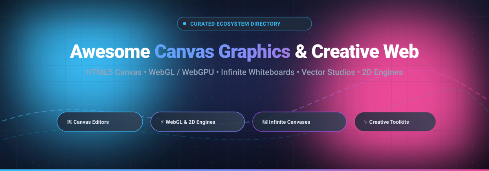

# 🎨 Awesome-Canvas-Graphics-Creative-Web-Dev

  

  
  
  
  
  
  

---

## 🌟 Top Canvas Graphics & Creative Web Dev Ecosystem

> **A Curated, SEO-Optimized Awesome Directory of SaaS/Hosted Platforms & Open-Source Projects**  
> *Targeted at HTML5 Canvas Design Editors, Vector & Raster Graphics Studios, Infinite Whiteboards, WebGL/WebGPU Rendering Engines, Generative Art, and Creative Web Development Toolkits.*  
>
> **📅 Last updated:** November 2026

This repository tracks notable **SaaS/hosted platforms** and **open-source projects** for **Canvas Graphics & Creative Web Dev**. These tools design, render, animate, manipulate, and export vector graphics, social visuals, UI prototypes, infinite canvases, and interactive browser-based design studios using HTML5 Canvas, SVG, WebGL/WebGPU, and modern frontend frameworks (React, Vue, Svelte, WebAssembly).

- **SaaS category leaders**: Canva, Figma, Adobe Express, Kittl, VistaCreate, Pixlr, PicMonkey, Desygner, Snappa, and Design Wizard.
- **Open-source ecosystem**: Penpot, Excalidraw, tldraw, Three.js, Anime.js, PixiJS, Phaser, Fabric.js, Graphite, p5.js, Rough.js, Motion Canvas, Paper.js, Konva.js, Satori, Cropper.js, SVG.js, Raphael, miniPaint, and CanvasAnvil.

Contributions are welcome! Please open a Pull Request to suggest new tools or update pricing and star counts.

---

## 📑 Table of Contents

- [📊 Sector Overview & Market Dynamics](#-sector-overview--market-dynamics)
- [☁️ SaaS & Hosted Platforms](#️-saas--hosted-platforms)
- [🔓 Open-Source GitHub Projects](#-open-source-github-projects)
- [🛠️ Key Frameworks for Building Custom Canvas Apps](#️-key-frameworks-for-building-custom-canvas-apps)
- [🤝 How to Contribute](#-how-to-contribute)
- [💖 Support & Share](#-support--share)
- [📈 Star History](#-star-history)
- [⚠️ Disclaimer](#️-disclaimer)

---

## 📊 Sector Overview & Market Dynamics

The global graphic design and creative software market is valued at approximately **$9.0 billion to $10.5 billion**, expanding at a **CAGR of 7% to 9.4%** driven by hardware-accelerated browser-based canvas runtimes (WebGL/WebGPU) and generative AI workflow automation. The sector exhibits a distinct barbell structure with high concentration at the top—dominated by multi-billion-dollar titans like Adobe, Canva, and Figma—encircled by a moderately fragmented periphery of specialized, niche visual editors, whiteboards, and lightweight web-based design studios.

---

## ☁️ SaaS & Hosted Platforms

*SaaS platforms ordered descending by scale (company valuation / annual revenue).*

| 🚀 Platform | 🏢 Scale (Valuation / Revenue) | 💳 Pricing (Starting Paid Tier) | 🎁 Free Tier / Trial Limits | 📝 Description |
| :--- | :--- | :--- | :--- | :--- |
| **[Adobe Express](https://adobe.com)** | ~$90B–$100B Market Cap (~$24B+ Rev, Adobe Inc.) | $9.99/mo (Premium plan, $99.99/yr) | Free forever: 5 GB cloud storage, 100K+ templates, ~4K fonts, 1 social channel scheduling; capped Firefly generative AI credits/month | Cloud-based creative design suite integrating Adobe Stock, Firefly generative AI, quick photo/video editing, and brand-consistent social media templates. |
| **[Canva](https://canva.com)** | $42B Valuation (~$3.5B ARR) | $15.00/user/mo ($120.00/yr for 1 person) | Free forever: 5 GB cloud storage, 1 Brand Kit (up to 3 colors), core drag-and-drop editor, limited AI credits; premium assets watermarked, no transparent background/SVG export | Leading browser-based graphic design and visual communication platform offering drag-and-drop templates, AI image/layout tools, brand kits, and multi-format publishing. |
| **[Figma](https://figma.com)** | ~$19.3B–$25B Market Cap / Post-IPO (~$1.06B ARR) | $15.00/editor/mo billed annually ($16.00/mo) | Free forever (Starter plan): Unlimited personal drafts & viewers, up to 3 collaborative team files (3 pages/file), 30-day version history, 500 monthly AI credits | Collaborative WebAssembly/WebGL-powered interface design, vector graphics, and prototyping platform featuring FigJam whiteboarding and Dev Mode handoff. |
| **[VistaCreate](https://vista.com)** | ~$1.4B–$2.0B Market Cap (~$1.9B Vista Seg Rev, Cimpress; $85M acq) | $13.00/mo ($120.00/yr billed annually at $10/mo) | Free forever (Starter plan): 10 GB cloud storage, 1 Brand Kit, 100K+ templates, 1M+ free assets, 1 seat; background remover and one-click resize locked | Online graphic design and animation editor providing thousands of customizable social, print, and marketing templates with built-in background removal. |
| **[Kittl](https://kittl.com)** | ~$144M–$250M Valuation (~$17.5M ARR) | $15.00/mo ($120.00/yr billed annually at $10/mo) | Free forever: Up to 5 active projects, 500 MB upload space, low-res exports (max 800px at 72 dpi), non-commercial use only, 200 non-refilling starter AI tokens | Browser-native graphic design studio specializing in advanced typography transformations, vector illustration workflows, textures, and print-on-demand templates. |
| **[PicMonkey (Shutterstock)](https://picmonkey.com)** | $110M Acquisition Price (by Shutterstock) | $7.99/mo (Basic plan, $72.00/yr) | 7-day free trial: Full feature access, requires payment info, auto-renews; free exploration mode restricts high-res saves/downloads to paid accounts | Web-based photo editing, retouching, and graphic design platform offering collage makers, brand templates, and layered canvas editing. |
| **[Pixlr](https://pixlr.com)** | ~$9.1M Annual Rev (Inmagine Group subsidiary) | $2.49/mo (Plus plan, $1.99/mo billed annually) | Free forever: Access to core Pixlr X/E tools; strictly capped at 2 file saves/downloads per day, workspace ads, and limited 20 one-time starter AI credits | Cloud-based photo editing and graphic design suite (`Pixlr X` and `Pixlr E`) bringing layer-based raster manipulation and AI generative tools directly to web browsers. |
| **[Desygner](https://desygner.com)** | ~$7.9M Annual Rev (Independent, Bootstrap/Growth) | $9.95/mo (Pro+ plan, $4.95/mo billed annually) | Free forever: Standard templates, free fonts/icons, 1-3 seats; premium stock integrations, PDF vector editor, and brand asset locking locked | Cross-platform cloud graphic design and digital asset management suite enabling teams to lock brand elements while scaling localized marketing visuals. |
| **[Snappa](https://snappa.com)** | ~$3.2M Annual Rev (Independent, Bootstrapped) | $15.00/mo (Pro plan, $120.00/yr billed annually at $10/mo) | Free forever (Starter plan): 1 user, access to 6,000+ templates & 5M+ HD photos; strictly capped at 3 downloads per month, no custom font uploads | Lightweight cloud graphic design tool engineered for marketers and content creators to produce social media graphics, display ads, and blog headers rapidly. |
| **[Design Wizard](https://designwizard.com)** | ~$1.2M Annual Rev (Independent) | $9.99/mo (Pro plan, $89.00/yr billed annually) | Free forever (Basic plan): Standard design tools, free asset catalog; strictly capped at 15 MB storage, premium assets pay-per-use, limited export resolutions | Browser-based graphic and video design tool featuring a curated library of licensed images, templates, and custom typography controls. |

---

## 🔓 Open-Source GitHub Projects

*Open-source repositories sorted descending by GitHub star counts. Each repo badge links directly to its stargazers page.*

1. **[Three.js (`mrdoob/three.js`)](https://github.com/mrdoob/three.js)**   
   The de facto standard JavaScript 3D WebGL and WebGPU rendering library used worldwide for interactive canvas visualizer experiences, immersive creative web dev, and browser animations.

2. **[Excalidraw (`excalidraw/excalidraw`)](https://github.com/excalidraw/excalidraw)**   
   Leading open-source virtual whiteboard and hand-drawn diagramming canvas with end-to-end encrypted real-time multiplayer collaboration and embeddable React SDK components.

3. **[Anime.js (`juliangarnier/anime`)](https://github.com/juliangarnier/anime)**   
   Lightweight yet powerful JavaScript animation engine that works seamlessly with CSS properties, SVG paths, DOM elements, and HTML5 Canvas objects.

4. **[Penpot (`penpot/penpot`)](https://github.com/penpot/penpot)**   
   The premier open-source collaborative design and prototyping tool (Figma alternative) built natively on open web standards (SVG, CSS Grid/Flexbox) with self-hosted Docker support.

5. **[tldraw (`tldraw/tldraw`)](https://github.com/tldraw/tldraw)**   
   A delightful infinite canvas SDK and collaborative whiteboarding engine for React, purpose-built for creating custom multiplayer spatial canvases, diagrams, and AI canvas interfaces.

6. **[PixiJS (`pixijs/pixijs`)](https://github.com/pixijs/pixijs)**   
   Blazing-fast 2D WebGL/WebGPU rendering engine for creating rich, hardware-accelerated interactive web graphics, games, and dynamic visual canvas experiences across desktop and mobile.

7. **[Phaser (`phaserjs/phaser`)](https://github.com/phaserjs/phaser)**   
   Fast, fun, and battle-tested HTML5 2D game framework utilizing Canvas and WebGL renderers across all modern desktop and mobile web browsers.

8. **[Fabric.js (`fabricjs/fabric.js`)](https://github.com/fabricjs/fabric.js)**   
   Foundational HTML5 Canvas library providing an interactive object model, SVG-to-Canvas parsing, built-in transform handles, image filters, and freehand drawing tools.

9. **[Graphite (`GraphiteEditor/Graphite`)](https://github.com/GraphiteEditor/Graphite)**   
   Modern open-source procedural 2D vector and raster graphics editor powered by a Rust-based node-graph engine compiled to WebAssembly for browser and desktop execution.

10. **[p5.js (`processing/p5.js`)](https://github.com/processing/p5.js)**   
    Complete JavaScript library for creative coding, generative art, and educational graphics programming using the full power of HTML5 Canvas and WebGL.

11. **[Rough.js (`rough-stuff/rough`)](https://github.com/rough-stuff/rough)**   
    Lightweight graphics library that lets you draw in a sketchy, hand-drawn-like style on HTML5 Canvas and SVG elements.

12. **[Motion Canvas (`motion-canvas/motion-canvas`)](https://github.com/motion-canvas/motion-canvas)**   
    Programmatic TypeScript vector animation framework featuring a real-time browser preview, precise audio synchronization, and modular video generation.

13. **[Paper.js (`paperjs/paper.js`)](https://github.com/paperjs/paper.js)**   
    Open-source vector graphics scripting framework that runs on top of the HTML5 Canvas, offering Bezier curve operations, boolean path logic, and scene-graph manipulation.

14. **[Konva.js (`konvajs/konva`)](https://github.com/konvajs/konva)**   
    High-performance 2D Canvas framework with React (`react-konva`) and Vue bindings, engineered for building drag-and-drop design editors, interactive stage objects, and canvas applications.

15. **[Satori (`vercel/satori`)](https://github.com/vercel/satori)**   
    Converts standard HTML and CSS flexbox layouts directly into crisp SVG and PNG graphics on the edge without requiring a headless browser runtime.

16. **[Cropper.js (`fengyuanchen/cropperjs`)](https://github.com/fengyuanchen/cropperjs)**   
    Industry-standard JavaScript image cropping library powered by HTML5 Canvas with touch support, zoom, rotation, and aspect ratio controls.

17. **[Theatre.js (`theatre-js/theatre`)](https://github.com/theatre-js/theatre)**   
    Motion design editor for the web that lets you animate Three.js, Canvas, SVG, or HTML elements using an interactive visual timeline and keyframing tools.

18. **[SVG.js (`svgdotjs/svg.js`)](https://github.com/svgdotjs/svg.js)**   
    Lightweight, dependency-free JavaScript library for manipulating and animating SVG elements with a clean, chainable API.

19. **[Raphaël (`DmitryBaranovskiy/raphael`)](https://github.com/DmitryBaranovskiy/raphael)**   
    Pioneering vector graphics library for the web providing cross-browser vector drawing and manipulation primitives.

20. **[Cocos Engine (`cocos/cocos-engine`)](https://github.com/cocos/cocos-engine)**   
    Comprehensive, open-source 2D and 3D cross-platform game and interactive graphics runtime written in TypeScript for web canvas, WebGL, and mobile apps.

21. **[SVG-Edit (`SVG-Edit/svgedit`)](https://github.com/SVG-Edit/svgedit)**   
    Embeddable browser-based vector graphics editor written in JavaScript for creating and modifying SVG drawings directly in modern browsers.

22. **[TOAST UI Image Editor (`nhn/tui.image-editor`)](https://github.com/nhn/tui.image-editor)**   
    Full-featured web image editor built on HTML5 Canvas featuring crop, flip, rotate, drawing, shape, icon, text, and mask filters.

23. **[Planck.js (`piqnt/planck.js`)](https://github.com/piqnt/planck.js)**   
    2D physics engine for HTML5 Canvas and JavaScript creative developers, rewritten as an idiomatic JavaScript version of Box2D.

24. **[miniPaint (`viliusle/miniPaint`)](https://github.com/viliusle/miniPaint)**   
    Lightweight open-source HTML5 online image and raster editor supporting layers, filters, color adjustments, healing brushes, and zero-server client-side exports.

25. **[CodingFeng101/CanvasAnvil (`CodingFeng101/CanvasAnvil`)](https://github.com/CodingFeng101/CanvasAnvil)**   
    Open-source HTML5 Canvas graphics toolkit engineered for building custom interactive visual editors, canvas workflows, and modular creative dev components.

---

## 🛠️ Key Frameworks for Building Custom Canvas Apps

- **Canva/Design Editor Clones**: Pair **Konva.js** (`react-konva`) or **Fabric.js** with an asset pipeline for drag-and-drop layers, text transformations, and multi-format exports.
- **Infinite Multiplayer Canvases**: Use **tldraw** or **Excalidraw** for spatial notes, flowcharts, and live multiplayer whiteboards.
- **Hardware-Accelerated 2D/3D**: Use **PixiJS** for ultra-fast 2D canvas/WebGL rendering or **Three.js** for full 3D interactive graphics.
- **Self-Hosted Design Systems**: Deploy **Penpot** for team-wide open standards SVG prototyping and collaborative UX design.

---

## 🤝 How to Contribute

Contributions are warmly welcomed! Help keep this ecosystem guide up-to-date:

1. 🍴 Fork the repository.
2. 🌿 Create a new feature branch (`git checkout -b feature/add-new-canvas-tool`).
3. 📝 Add your tool to `README.md` following the established table or badge structure.
4. 🔍 Ensure descriptions are factual, pricing is verified, and repository links point to official sites.
5. 🚀 Submit a Pull Request with a brief description of the addition.

---

## 💖 Support & Share

If you find this curated creative web development list helpful, consider supporting the maintainer:

- ⭐ **Star this repository** to help other developers and designers discover it.
- 🍴 **Fork & Share** it with your engineering team, design department, or creative coding community on X/Twitter, LinkedIn, and Reddit.
- ☕ **Buy me a coffee / Sponsor**: Support ongoing maintenance and open-source curation on the [GitHub Sponsors Dashboard](https://github.com/sponsors/ishandutta2007)!

  

---

## 📈 Star History

---

## ⚠️ Disclaimer

- This is a **community-curated** list maintained for informational and educational purposes — entries do not imply formal endorsement.
- Exporting high-resolution print assets (300 DPI CMYK/PDF) from browser canvases requires color-profile transformation, as HTML5 Canvas natively operates in sRGB.
- Always verify commercial asset licenses and web font redistribution rights before deploying custom templates in commercial applications.

---

  <b>Made with 🎨 for creative frontend developers, UI/UX designers, generative artists, and open-source builders worldwide.</b>

